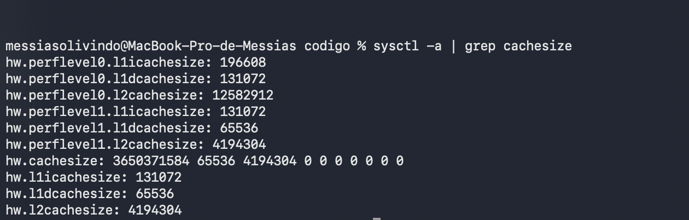
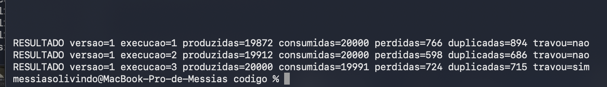
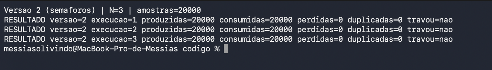
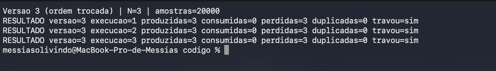

**Aluno:** Messias Olivindo | **D1** = 7 | **D2** = 5 | **N** = 3

# Ponderada CC08: do pipeline ao deadlock (Tato)

**Parâmetros calculados**

| parâmetro | conta | valor |
|---|---|---|
| D1 | "Messias" tem 7 letras | **7** |
| D2 | 7 + 8 ("Olivindo") = 15 letras; último dígito | **5** |
| IC (instruções por amostra) | 100.000 + 20.000 × 5 | **200.000** |
| m (taxa de falta na L1) | 3% + 0,5% × 7 | **6,5%** |
| N (buffer da A4) | 3 + (5 mod 5) = 3 + 0 | **3** |

---

# Parte A: o problema técnico

## A1. Arquitetura e memória: qual processador vai na pulseira?

### A1.1 Plataforma H, tempo por amostra

```
ciclos = IC × CPI           = 200.000 × 1,5   = 300.000 ciclos
tempo  = ciclos / clock     = 300.000 / 48 MHz = 6,25 ms
```

**Não atende.** 6,25 ms > 5 ms (estoura em 1,25 ms, 25% acima do limite). Na H não há cache nem SO, então não existe pior caso diferente: o tempo é sempre 6,25 ms.

### A1.2 Plataforma V, AMAT, CPI efetivo e pior caso

```
AMAT = tempo de acerto + m × penalidade
     = 1 + 0,065 × 120 = 1 + 7,8 = 8,8 ciclos   (= 8,8 / 1,2 GHz ≈ 7,3 ns)

CPI efetivo = 1,0 + (acessos por instrução × m × penalidade)
            = 1,0 + (1,3 × 0,065 × 120) = 1,0 + 10,14 = 11,14

ciclos = 200.000 × 11,14        = 2.228.000 ciclos
tempo  = 2.228.000 / 1,2 GHz    = 1,857 ms
pior caso = 1,857 ms + 3 ms (Linux) = 4,857 ms
```

**Atende, por pouco.** 4,857 ms < 5 ms, com folga de **0,143 ms (2,9%)**. A folga depende de o Linux nunca passar de 3 ms.

### A1.3 Plataforma H com DSP (Lei de Amdahl)

```
S = 1 / ((1 − f) + f / s) = 1 / ((1 − 0,6) + 0,6 / 5)
  = 1 / (0,4 + 0,12) = 1 / 0,52 = 1,923

tempo novo = 6,25 ms / 1,923 = 3,25 ms     (confere: 6,25 × 0,52)
```

**Atende**, com folga de **1,75 ms (35%)**, e sem sistema operacional que possa atrasar a tarefa.

### Resumo da A1

| plataforma | tempo por amostra | pior caso | atende 5 ms? | folga |
|---|---|---|---|---|
| H | 6,25 ms | 6,25 ms | não | −1,25 ms |
| V | 1,857 ms | 4,857 ms | sim | 0,143 ms |
| H + DSP | 3,25 ms | 3,25 ms | sim | 1,75 ms |

### A1.4 Por que a V precisa de cache e a H funciona sem

Na V, instruções e dados passam pelo mesmo caminho até a DRAM, que custa 120 ciclos por acesso: esse é o gargalo de Von Neumann. Sem cache, cada instrução (1,3 acessos) custaria 1,3 × 120 = 156 ciclos a mais: CPI = 157, tempo = 200.000 × 157 / 1,2 GHz = **26,2 ms**, mais de 5 vezes o limite. A cache L1 (acerto em 1 ciclo) esconde a DRAM. A H é Harvard: memória de instruções e de dados separadas, ambas SRAM interna de 1 ciclo. Busca de instrução e acesso a dado acontecem em paralelo e nunca esperam uma DRAM, então não há gargalo para esconder.

### A1.5 Evidência da minha máquina

Mac com Apple M1 Pro. Comando: `sysctl -a | grep cachesize`



Trecho relevante da saída:

```
hw.perflevel0.l1icachesize: 196608     (núcleos de desempenho: 192 KB)
hw.perflevel0.l1dcachesize: 131072     (128 KB)
hw.perflevel0.l2cachesize:  12582912   (12 MB, unificada)
hw.perflevel1.l1icachesize: 131072     (núcleos de eficiência: 128 KB)
hw.perflevel1.l1dcachesize: 65536      (64 KB)
hw.perflevel1.l2cachesize:  4194304    (4 MB, unificada)
```

**A L1 é dividida em instruções e dados?** Sim, nos dois tipos de núcleo (por exemplo 192 KB de instruções + 128 KB de dados nos núcleos de desempenho). **Então o computador é Von Neumann ou Harvard?** Os dois, em níveis diferentes: na L1 ele se comporta como **Harvard** (caminhos separados para instrução e dado, as duas buscas acontecem no mesmo ciclo). Da L2 para baixo e na RAM ele é **Von Neumann**: a L2 é unificada e programa e dados vivem no mesmo espaço de endereçamento. Isso se chama **Harvard modificada**. É a mesma ideia da Plataforma V: o gargalo de Von Neumann fica na memória principal e as caches L1 separadas o escondem.

---

## A2. Pipeline: o loop do filtro

### A2.1 Dependências de dados (RAW)

| # | quem depende | de quem | registrador | tipo |
|---|---|---|---|---|
| 1 | I2 `add` | I1 `lw` | x5 | load-use |
| 2 | I4 `sub` | I2 `add` | x6 | ALU → ALU |
| 3 | I4 `sub` | I3 `lw` | x7 | load-use |
| 4 | I5 `sw` | I4 `sub` | x6 | ALU → store |

I6 e I7 não têm RAW dentro do trecho: escrevem x10 e x11, que I1 e I3 só leram antes (isso é WAR, não RAW, e não atrapalha um pipeline em ordem).

### A2.2 Sem forwarding: 17 ciclos

Regras: o banco de registradores escreve na 1ª metade do ciclo e lê na 2ª, então o consumidor pode ler (ID) no **mesmo ciclo** em que o produtor faz WB. `--` é bolha (instrução parada esperando). ME = MEM.

```
                    1  2  3  4  5  6  7  8  9 10 11 12 13 14 15 16 17
1 lw x5,0(x10)     IF ID EX ME WB
2 add x6,x6,x5        IF ID -- -- EX ME WB
3 lw x7,0(x11)           IF -- -- ID EX ME WB
4 sub x6,x6,x7                    IF ID -- -- EX ME WB
5 sw x6,0(x12)                       IF -- -- ID -- -- EX ME WB
6 addi x10,x10,4                              IF -- -- ID EX ME WB
7 addi x11,x11,4                                       IF ID EX ME WB
```

```
base: 7 instruções + 4 ciclos de enchimento = 11 ciclos
bolhas: I2 espera x5 (2) + I4 espera x7 (2) + I5 espera x6 (2) = 6
total = 11 + 6 = 17 ciclos
```

### A2.3 Com forwarding: 13 ciclos

```
                    1  2  3  4  5  6  7  8  9 10 11 12 13
1 lw x5,0(x10)     IF ID EX ME WB
2 add x6,x6,x5        IF ID -- EX ME WB
3 lw x7,0(x11)           IF -- ID EX ME WB
4 sub x6,x6,x7                 IF ID -- EX ME WB
5 sw x6,0(x12)                    IF -- ID EX ME WB
6 addi x10,x10,4                        IF ID EX ME WB
7 addi x11,x11,4                           IF ID EX ME WB
```

```
total = 11 + 2 bolhas = 13 ciclos
```

**Que dependência ainda causa bolha?** As duas **load-use**: I1 → I2 (x5) e I3 → I4 (x7). O dado de um `lw` só existe no **fim do estágio MEM**. A instrução seguinte precisa dele no **início do EX**, que acontece no mesmo ciclo em que o `lw` ainda está no MEM. Não dá para enviar um dado para trás no tempo, então sobra 1 bolha por load-use. As dependências ALU → ALU (I2 → I4) e ALU → store (I4 → I5) são resolvidas pelo forwarding sem bolha.

### A2.4 Reordenando para eliminar todas as bolhas: 11 ciclos

Nova ordem: trocar as linhas 2 e 3 (`lw x7` sobe, `add` desce). O resultado não muda: `add` lê x5 e x6 e escreve x6; `lw x7` lê x11 e escreve x7; as duas instruções não se tocam.

```
1 lw  x5, 0(x10)
3 lw  x7, 0(x11)      <- sobe: ocupa o atraso do load-use de x5
2 add x6, x6, x5      <- x5 já chegou por forwarding
4 sub x6, x6, x7      <- x7 já chegou (o add ficou no meio)
5 sw  x6, 0(x12)
6 addi x10, x10, 4
7 addi x11, x11, 4
```

```
                    1  2  3  4  5  6  7  8  9 10 11
1 lw x5,0(x10)     IF ID EX ME WB
3 lw x7,0(x11)        IF ID EX ME WB
2 add x6,x6,x5           IF ID EX ME WB
4 sub x6,x6,x7              IF ID EX ME WB
5 sw x6,0(x12)                 IF ID EX ME WB
6 addi x10,x10,4                  IF ID EX ME WB
7 addi x11,x11,4                     IF ID EX ME WB
```

**Total: 11 ciclos, zero bolhas** (o mínimo para 7 instruções: 7 + 4). Ganho: 17 → 13 → 11 ciclos.

---

## A3. Processos e threads: como organizar o software

### A3.1 Organização proposta (Plataforma V)

| tarefa | vira | por quê |
|---|---|---|
| ler o sensor | **thread** do processo principal | caminho crítico dos 5 ms |
| processar a amostra | **thread** do processo principal | lê o mesmo buffer do sensor |
| acionar o motor | **thread** do processo principal | lê o resultado do processamento |
| falar com o celular (BLE) | **processo separado** | recebe dados de fora e não é crítico |

```
 ┌─ processo principal ───────────────────┐        ┌─ processo BLE ───┐
 │ thread sensor ─> thread processar ─>   │  IPC   │ log para o app   │
 │                  thread motor          │ <────> │ comandos de      │
 │   (memória compartilhada: buffer)      │ (pipe) │ configuração     │
 └────────────────────────────────────────┘        └──────────────────┘
```

| critério | threads (sensor, processar, motor) | processo separado (BLE) |
|---|---|---|
| compartilhar memória | mesmo espaço de endereços: passam amostras pelo buffer, sem copiar | memória isolada: troca só mensagens pequenas (log, comandos), sem custo no caminho crítico |
| custo de criação | menor (não cria espaço de endereços novo) | maior, mas paga uma vez na inicialização |
| troca de contexto | mais barata (mesmo espaço de endereços) | mais cara, mas fora do caminho dos 5 ms |
| isolamento de falhas | sem isolamento: uma thread com defeito derruba o processo inteiro | se o BLE travar ou cair, o sensor e o motor continuam |

**Ligação com a A1:** na V a folga é de só 0,143 ms. Por isso o caminho crítico (sensor → processar → motor) fica em threads do mesmo processo, sem IPC no meio. A comunicação por IPC só existe para log e configuração, que não precisam cumprir os 5 ms.

### A3.2 BLE como thread × como processo

| | BLE como thread | BLE como processo |
|---|---|---|
| quem explora uma falha ganha | acesso a **todo o espaço de endereços**: amostras, buffer, controle do motor | só a memória do processo BLE |
| o que o atacante consegue | corromper dados, travar tudo, mandar o motor vibrar errado | travar o BLE; para atingir o resto, precisa de uma segunda falha (no IPC ou no kernel) |
| defesa possível | quase nenhuma (mesmos privilégios) | usuário sem privilégios, permissões limitadas e validação de cada mensagem do IPC |

O processo separado não torna o BLE invulnerável, mas a MMU do sistema operacional vira uma barreira entre a falha e o motor.

### A3.3 Diagrama de estados de um processo

```
                    admitido                     escalonado
        ┌──────┐ ───────────> ┌────────┐ ─────────────────> ┌────────────┐
        │ novo │              │ pronto │                    │ executando │
        └──────┘              └────────┘ <───────────────── └────────────┘
                                 ▲  ▲       preempção            │   │
                                 │  │      (acabou o quantum)    │   │ termina
                 evento ocorreu  │  └────────────────────────────┘   ▼
                (timer, I/O pronto)                           ┌───────────┐
                                 │            espera por      │ terminado │
                           ┌───────────┐ <─── evento/I/O ─────┴───────────┘
                           │ bloqueado │      (sai de executando)
                           └───────────┘
```

Transições: novo → pronto; pronto → executando; executando → pronto (preempção); executando → bloqueado (espera timer ou I/O); bloqueado → pronto (evento ocorreu); executando → terminado.

**Em que estado a thread do sensor passa mais tempo? Bloqueado.** Ela só precisa agir a cada 10 ms (100 amostras por segundo) e passa o resto esperando o timer e a resposta do barramento. Mesmo supondo o pior caso, em que ela gaste todo o tempo de processamento da amostra executando (1,857 ms em cada 10 ms), ela ficaria **no máximo 18,6% executando e pelo menos 81,4% bloqueada**.

---

## A4. Código com semáforos: o buffer entre o sensor e o motor

Código em [`codigo/`](codigo/). Python 3, N = 3, 20.000 amostras, 3 execuções por versão. Um vigia encerra o programa quando o consumidor passa 1 s sem receber nada e registra "travou".

**Como contei:** *produzidas* = amostras que o produtor gerou; *consumidas* = leituras do consumidor; *perdidas* = amostras produzidas que o consumidor nunca recebeu; *duplicadas* = repetições de amostras que o consumidor recebeu mais de uma vez.

| versão | exec. | produzidas | consumidas | perdidas | duplicadas | travou |
|---|---|---|---|---|---|---|
| 1 (sem sincronização) | 1 | 19872 | 20000 | 766 | 894 | não |
| 1 | 2 | 19912 | 20000 | 598 | 686 | não |
| 1 | 3 | 20000 | 19991 | 724 | 715 | **sim** |
| 2 (semáforos) | 1 | 20000 | 20000 | 0 | 0 | não |
| 2 | 2 | 20000 | 20000 | 0 | 0 | não |
| 2 | 3 | 20000 | 20000 | 0 | 0 | não |
| 3 (ordem trocada) | 1 | 3 | 0 | 3 | 0 | **sim** |
| 3 | 2 | 3 | 0 | 3 | 0 | **sim** |
| 3 | 3 | 3 | 0 | 3 | 0 | **sim** |

Prints de uma execução de cada versão:







### Região crítica da versão 1 e por que perde e duplica

A região crítica é o trio **ler `ocupadas`, `sleep(0)`, escrever `ocupadas`**, que o produtor faz com `+ 1` e o consumidor com `− 1`, mais as posições do buffer (`entra`, `sai`). Nada impede que as duas threads estejam dentro dela ao mesmo tempo.

```
 ocupadas = 1 (uma amostra não lida)
 consumidor: lê tmp=1 ......... (sleep(0): é interrompido)
 produtor:   grava, lê tmp=1, escreve 2
 consumidor: volta e escreve tmp-1 = 0     <- apagou a conta do produtor
 resultado: há 2 amostras no buffer, o contador diz 0
```

- **Contador menor que o real:** o produtor acha que há vaga onde ainda há amostra não lida e a sobrescreve. A amostra é **perdida**.
- **Contador maior que o real:** o consumidor acha que há amostra onde a posição já foi lida e lê de novo. A amostra é **duplicada**.

Nas execuções 1 e 2 o consumidor fez 20.000 leituras mesmo com só 19.872 e 19.912 amostras produzidas: ele leu posições velhas, e isso é a duplicata. Na execução 3 o contador corrompido deixou o consumidor esperando uma amostra que não chegou: travou.

### O que cada semáforo garante na versão 2

| semáforo | começa em | garante |
|---|---|---|
| `vazio` | N = 3 | conta as vagas livres: o produtor **bloqueia com o buffer cheio** e nunca sobrescreve uma amostra não lida |
| `cheio` | 0 | conta as amostras disponíveis: o consumidor **bloqueia com o buffer vazio** e nunca lê posição velha |
| `mutex` | 1 | exclusão mútua: só **uma thread por vez** mexe nos índices e no buffer |

Os três juntos eliminam a condição de corrida (0 perdidas, 0 duplicadas) e também a espera ocupada: a thread que não pode avançar dorme em vez de gastar CPU.

### O que aconteceu na versão 3 e por quê

O produtor passou a pegar o `mutex` **antes** de esperar uma vaga em `vazio`. Com N = 3, ele grava 3 amostras, tenta uma 4ª, encontra o buffer cheio e **fica esperando `vazio` segurando o `mutex`**. O consumidor precisa do `mutex` para ler e liberar uma vaga: ele espera o produtor, e o produtor espera o consumidor. Nenhum dos dois avança: **deadlock**.

```
 produtor:    segura [mutex] ──espera──> [vazio]  (só o consumidor libera)
 consumidor:  segura nada     ──espera──> [mutex] (só o produtor libera)
```

Nas 3 execuções ele aconteceu logo no começo: 3 amostras produzidas, 0 consumidas, vigia de 1 s encerrou. O travamento depende de o buffer chegar a encher com o produtor segurando o `mutex`; aqui isso aconteceu 3 de 3 vezes. A trava é **total**: não degrada, para.

---

## A5. Deadlock: a pulseira congelou

Código reconstruído do enunciado:

```
sensor:  P(i2c); le_sensor();  P(log); registra();       V(log); V(i2c)
log:     P(log); le_log();     P(ble); envia();          V(ble); V(log)
config:  P(ble); recebe_comando(); P(i2c); ajusta_sensor(); V(i2c); V(ble)
```

### A5.1 Sequência que leva ao deadlock

| passo | thread | ação | resultado |
|---|---|---|---|
| 1 | sensor | P(i2c) | pega o I2C |
| 2 | log | P(log) | pega o log |
| 3 | config | P(ble) | pega o rádio |
| 4 | sensor | P(log) | **bloqueia** (o log é da thread log) |
| 5 | log | P(ble) | **bloqueia** (o rádio é da config) |
| 6 | config | P(i2c) | **bloqueia** (o I2C é do sensor) |

Grafo de alocação de recursos nesse instante (círculo = thread, quadrado = recurso):

```
   (sensor) ──quer──> [LOG] ──é de──> (thread_log)
      ▲                                     │
      │                                   quer
   é de                                     ▼
    [I2C] <──quer── (config) <──é de── [BLE]
```

Há um **ciclo**: sensor → LOG → log → BLE → config → I2C → sensor. Nenhuma das três threads avança, e o sensor parado é a pulseira congelada.

### A5.2 As quatro condições necessárias

| condição | onde aparece no código |
|---|---|
| **exclusão mútua** | cada recurso é um semáforo que começa em 1: só uma thread por vez usa o I2C, o log ou o rádio |
| **posse e espera** | o sensor segura o I2C enquanto pede o log; o log segura o log enquanto pede o rádio; a config segura o rádio enquanto pede o I2C |
| **não preempção** | um semáforo só é liberado pelo dono, com V(). Ninguém tira o I2C do sensor à força |
| **espera circular** | sensor espera log, log espera rádio, config espera I2C: as três esperas formam um ciclo (ordens de aquisição: i2c→log, log→ble, ble→i2c) |

### A5.3 Duas correções de tipos diferentes

**1. Prevenção: quebrar a espera circular com uma ordem global de recursos (I2C < log < BLE).**
Toda thread só pede recursos nessa ordem. Sensor (i2c→log) e log (log→ble) já cumprem. A config deve receber o comando segurando só o BLE, liberá-lo e depois pegar o I2C (ou pegar i2c antes do ble), para nunca pedir um recurso menor segurando um maior. Sem ciclo possível, o deadlock não acontece.
*O que muda para quem usa:* nada que se perceba. A pulseira não congela mais por esse motivo. O único efeito é que um comando de configuração pode demorar alguns milissegundos a mais para ser aplicado. O custo é da equipe: reescrever o código e testar (a mesma ideia da versão 2 da A4, que rodou 20.000 amostras sem travar).

**2. Detecção e recuperação: watchdog.**
Um cronômetro de hardware que o software precisa "alimentar" a cada ciclo do loop do sensor. Se o deadlock impedir o sensor de avançar, o cronômetro estoura e a pulseira **reinicia sozinha**.
*O que muda para quem usa:* a pessoa fica **cerca de 4 segundos sem vibração**, avisada por um pulso longo, e uma configuração em andamento é perdida. É melhor que congelar até desligar e ligar, mas **não conserta a causa**.

As duas são complementares: a ordem global previne o defeito conhecido e o watchdog protege contra defeitos que ainda não foram descobertos.

---

# Parte B: a decisão do CTO

## Memorando ao conselho da Tato

**Assunto:** lançamento e edital (Dilema 1)

**Decisão: adiar o lançamento em 2 meses para entregar sem o deadlock, e aceitar a perda do edital.**

**Do que estou abrindo mão.** Do edital que financia as primeiras 2.000 pulseiras. O próximo financiamento parecido só aparece daqui a cerca de 6 meses. Quem paga é a **Tato**, que fica ~6 meses sem esse dinheiro, e as **2.000 pessoas** que esperariam mais tempo pela pulseira. Esse custo é real e eu o assumo.

**O número que pesou.** Na versão 3 da A4 reproduzi o deadlock: nas 3 execuções, **0 de 20.000 amostras foram processadas**. A trava não degrada o produto, ela o desliga. O watchdog reduz a trava a ~4 s, mas 4 s são **400 amostras** a 100 por segundo, **800 vezes** o limite de 5 ms. É o cenário que o requisito inegociável existe para evitar: a pessoa anda sem saber que há um poste na frente. A taxa é de 1 trava a cada 10.000 h por pulseira, baixa para uma pessoa, mas com 2.000 pulseiras e uso de 8 h por dia (suposição minha, o enunciado não dá o uso) são **1,6 travas por dia na frota**. Em 2 meses seriam cerca de 96 travas, cada uma com a pessoa sem aviso, em plena rua.

**Impacto em quem usa e risco de segurança.** O usuário recebe um produto em que o defeito conhecido foi corrigido na origem (ordem global de recursos, A5.3) e que ainda leva o watchdog como segunda camada. O risco de segurança da opção escolhida é de outra natureza: dois meses de reescrita podem introduzir um defeito novo. Mitigo com testes de estresse no formato da A4 (20.000 amostras, 3 execuções, zero perda e zero travamento como critério de entrega). Um produto de segurança pessoal lançado com um defeito conhecido também custa confiança do mercado, e essa confiança é mais difícil de recuperar do que um edital.

**O que me faria mudar de ideia.** (1) Se o caixa da Tato **não cobrir 6 meses sem o edital**, lanço com o watchdog, porque sem a empresa não há produto seguro nenhum. (2) Se a correção por ordem global de recursos passar na bateria de testes de estresse **em até 3 semanas**, antes de o edital fechar, submeto com o produto já corrigido.

Refs: A4 (versão 3), A5, A1.
